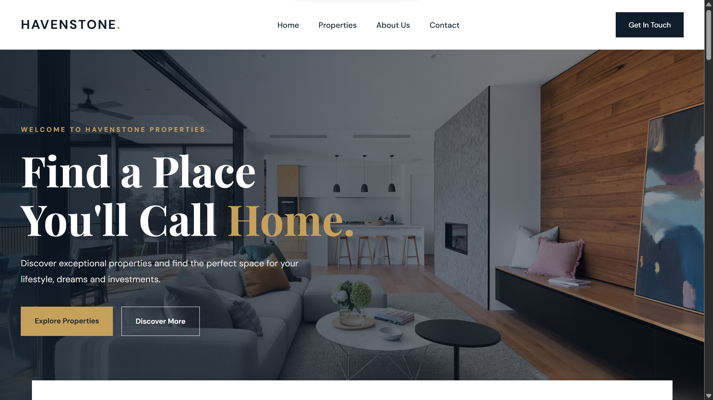

# Havenstone Properties

A modern, premium and responsive real estate website designed to help users discover properties, explore investment opportunities and make enquiries.

## Project Overview

Havenstone Properties is a fictional real estate website developed as a frontend portfolio project. It features an elegant design, property listings, interactive search functionality and WhatsApp enquiry integration.

## Features

- Modern luxury design.
- Responsive navigation with mobile hamburger menu.
- Property search and filtering by type, location and budget.
- Featured property listings.
- Interactive property details pop-up.
- WhatsApp property enquiries.
- About Us section.
- Real estate services section.
- Why Choose Us section.
- Statistics section.
- Testimonials section.
- Contact form with WhatsApp integration.
- Scroll reveal animations.
- Responsive layouts for mobile, tablet and desktop.
- SEO metadata.

## Technologies Used

- HTML5
- CSS3
- JavaScript
- Google Fonts
- Unsplash Images

## Project Structure

```text
havenstone-properties/
│
├── index.html
├── style.css
├── script.js
└── README.md
```

## Getting Started

1. Clone the repository.
2. Open the project folder in Visual Studio Code.
3. Open `index.html` using Live Server.

## Important Note

This is a fictional portfolio project. Property listings, testimonials and statistics are demonstration content and do not represent verified business records.

## Developer

Developed as a frontend web development portfolio project.

## License

This project is intended for educational and portfolio demonstration purposes.
## Website Preview



## Live Website

https://havenstone-properties.netlify.app/